<picture>
  <source media="(prefers-color-scheme: dark)" srcset="assets/banner-dark.svg">
  <source media="(prefers-color-scheme: light)" srcset="assets/banner-light.svg">
  
</picture>

  
  

## 👋 Hi, I'm Michael

I help teams design secure cloud platforms, modernize applications, and build grounded AI solutions. My background spans **16+ years** across financial services, healthcare, energy, media, and the public sector.

## 🔭 What I'm Building Now

### 🤖 [Foundry Agent Lab](https://github.com/michael-rechani/foundry-agent-accelerator)

Secure infrastructure. Purpose-built AI agents. A streamlined API with tools to monitor and improve performance.

## 🎯 What I Focus On

- 🧠 **Enterprise AI** — RAG, grounded assistants, and agentic workflows on Microsoft Foundry and Azure OpenAI.
- ☸️ **Application Modernization** — Cloud-native architecture, AKS, containers, and GitOps.
- 🏗️ **Platform Engineering** — Terraform and Bicep, CI/CD with GitHub Actions, and developer enablement.
- 🛡️ **Cloud Architecture** — Landing zones, hybrid cloud, security, private networking, and resilience.

## 🧰 Tech Stack

<picture>
  <source media="(prefers-color-scheme: dark)" srcset="https://skillicons.dev/icons?i=azure,aws,kubernetes,docker,terraform,githubactions,python,powershell,cs,bash,git,vscode&theme=dark">
  
</picture>

**AI & agents** 

**Cloud-native** 

## 📜 Certifications

## 🎓 Education

B.S. in Information Systems, *cum laude*, Ramapo College of New Jersey

---

Opinions are my own.

