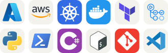
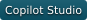

<!-- Icons and badges are saved copies in assets/ (from skillicons.dev and shields.io) so they can't time out through GitHub's image proxy. -->

<picture>
  <source media="(prefers-color-scheme: dark)" srcset="assets/banner-dark.svg">
  <source media="(prefers-color-scheme: light)" srcset="assets/banner-light.svg">
  
</picture>

   
  
  &nbsp;
  

## 👋 Hi, I'm Michael

I help teams design secure cloud platforms, modernize applications, and build grounded AI solutions. My background spans **16+ years** across financial services, healthcare, energy, media, and the public sector.

## 🔭 What I'm Building Now

- 🤖 **[Foundry Agent Lab](https://github.com/michael-rechani/foundry-agent-accelerator)** — Hosted-agent samples on Microsoft Foundry: a private web app, prebuilt review agents, and Terraform for a private-network deployment.
- 📊 **[PTU & APIM Monitoring](https://github.com/michael-rechani/apim-ptu-monitoring)** — Azure Monitor workbooks and metric exports to validate PTU and APIM Standard v2 usage, with no Log Analytics required.
- 🗂️ **[App Consult / FDE Catalog](https://github.com/michael-rechani/app-consult-fde-catalog)** — A single front door to App Consult and FDE program resources.

## 🎯 What I Focus On

- 🧠 **Enterprise AI** — RAG, grounded assistants, and agentic workflows on Foundry and Azure OpenAI.
- ☸️ **App Modernization** — AKS, containers, and GitOps.
- 🏗️ **Platform Engineering** — Terraform, Bicep, GitHub Actions, and developer enablement.
- 🛡️ **Cloud Architecture** — Landing zones, hybrid cloud, security, and private networking.

## 🧰 Tech Stack

<picture>
  <source media="(prefers-color-scheme: dark)" srcset="assets/tech-stack-dark.svg">
  
</picture>

**AI & agents** 

**Cloud-native** 

## 📜 Certifications

<table>
  <tr>
    <td align="center" width="200">
       
      <b>Azure Solutions Architect Expert</b>
    </td>
    <td align="center" width="200">
       
      <b>Azure AI Fundamentals</b>
    </td>
  </tr>
</table>

## 🎓 Education

B.S. in Information Systems, *cum laude*, Ramapo College of New Jersey

## 📫 Connect

[linkedin.com/in/michaelrechani](https://www.linkedin.com/in/michaelrechani/)

---

Opinions are my own.

